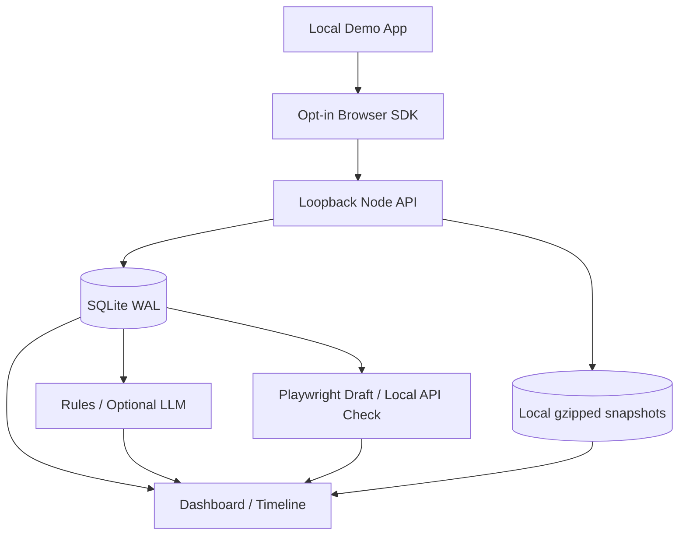

# 架构与权衡

- **Ingest 幂等性**：每个会话事件都携带唯一 `seq`，SQLite 有 `(session_id,seq)` 唯一约束。重试不应增加同一条错误的发生次数。
- **快照保守策略**：不执行目标仓库代码、不保存表单字段与媒体、不存网络数据体。预览只是部分 DOM 树的静态结构；非视频，不承诺 UI 像素还原。
- **AI 输出验证**：只接受存在于事件白名单中的证据 ID；错误返回显式失败；规则模式始终标记为假设。
- **受控复现**：只为内置 Demo 生成测试代码，不执行外部脚本；验证接口检查 Demo API 合约，不声称是浏览器回归测试。
- **取舍**：V1 用 Node 内置 SQLite 与零依赖前端代替最初设计的 PostgreSQL/Redis/Vue 架构，以实现无需网络安装的可复现实验与真正运行的 E2E 闭环。多租户、安全 SDK 的复杂采集模式和正式 rrweb 录制未来再增加。
